# GStreamer Knowledge Map và Workflow tổng thể

> **Mục đích:** Hệ thống hóa các khái niệm, keyword và luồng hoạt động quan trọng của GStreamer trong Embedded Linux camera.
> **Phạm vi:** Bài 1–8 là nền tảng; [Bài 09](09-gstreamer-runtime-integration-and-interview-guide.md) và [Lab 09](../practice/lesson-09/README.md) giới thiệu runtime integration bằng ví dụ tổng hợp.
> **Cách đọc:** Đi từ sơ đồ lộ trình → kiến trúc → object model → dataflow → caps → V4L2 capture → state → Bus → application integration.

> **Điểm bắt đầu:** [Bảng đối chiếu lý thuyết ↔ lab](README.md). Bằng chứng CamStream Control trong tài liệu không phải kết quả của các lab trong repo này.

> **Cách xem sơ đồ:** Mermaid chỉ được render khi file được mở bằng một Markdown renderer có hỗ trợ Mermaid, chẳng hạn trang rendered Markdown trên GitHub. Mở file `.md` trực tiếp như file văn bản, dùng chế độ **Raw**, hoặc dùng trình preview không hỗ trợ Mermaid sẽ chỉ hiện code block.


---

# 1. Bản đồ kiến thức tổng quan

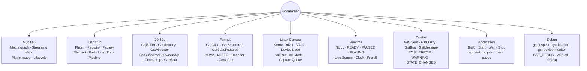

## Mental model một câu

```text
GStreamer xây một graph từ các element, thương lượng format bằng caps,
truyền payload bằng GstBuffer, điều khiển runtime bằng state/event/query
và báo kết quả cho application qua GstBus.
```

---

# 2. Lộ trình học và quan hệ giữa các bài

```mermaid
flowchart LR
    B1["Bài 1<br/>Tổng quan kiến trúc"] --> B2["Bài 2<br/>Plugin, Element, Pad, Bin, Pipeline"] --> B3["Bài 3<br/>GstBuffer, GstMemory, Ownership"] --> B4["Bài 4<br/>YUY2, MJPEG, Raw và Compressed"] --> B5["Bài 5<br/>GstCaps và Negotiation"] --> B6["Bài 6<br/>V4L2 và v4l2src"] --> B7["Bài 7<br/>State Machine và Live Source"] --> B8["Bài 8<br/>GstBus, GstMessage và Error Handling"]

    B8 --> B9["Bài 9<br/>Clock, tee/queue, appsink/appsrc"]
    B9 --> N1["Nâng cao<br/>Synchronization, QoS, latency"]
    N1 --> N2["Nâng cao<br/>tee, queue, Threading"]
    N2 --> N3["Nâng cao<br/>Backpressure, Latency, Drop Policy"]
    N3 --> N4["Nâng cao<br/>appsink, appsrc, Service Integration"]
```

## Mỗi bài trả lời câu hỏi gì?

| Bài | Câu hỏi trung tâm |
|---|---|
| Bài 1 | GStreamer đứng ở đâu trong hệ thống camera? |
| Bài 2 | Graph được tạo từ những object nào? |
| Bài 3 | Dữ liệu được chứa, sở hữu và truyền như thế nào? |
| Bài 4 | Payload trong buffer biểu diễn YUY2 hoặc MJPEG ra sao? |
| Bài 5 | Các element thống nhất format bằng cách nào? |
| Bài 6 | Camera V4L2 được đưa vào graph qua `v4l2src` như thế nào? |
| Bài 7 | Pipeline mở, chạy, pause và release resource ra sao? |
| Bài 8 | Application nhận EOS, lỗi và trạng thái bằng cách nào? |
| Bài 9 | Clock, nhánh xử lý và ranh giới C++/pipeline hoạt động ra sao? |
| Nâng cao | Thread, clock, latency và application integration được tổ chức thế nào? |

**Đường đi để tự kiểm tra:** Sau mỗi bài, mở lab cùng số trong [bảng mapping](README.md), chạy ví dụ và đọc tiêu chí PASS. Một chủ đề được nhắc trong lý thuyết mà không có ví dụ tương ứng phải được coi là *chưa kiểm chứng bằng lab*. Ví dụ: `bytesused` của V4L2, caps renegotiation, Bus poll-fd và zero-copy.

**Trọng tâm phỏng vấn và công việc:** giải thích được object/pad/caps/ownership, truy được nguồn gốc `not-negotiated`, phân biệt `ASYNC` với `NO_PREROLL`, đọc Bus error, chọn V4L2 capture node, và chứng minh FPS/latency bằng số đo. [Bài 09](09-gstreamer-runtime-integration-and-interview-guide.md) bổ sung clock, `tee`/`queue`, `appsink`/`appsrc`, backpressure và quy trình debug.

---

# 3. Kiến trúc camera Embedded Linux và GStreamer

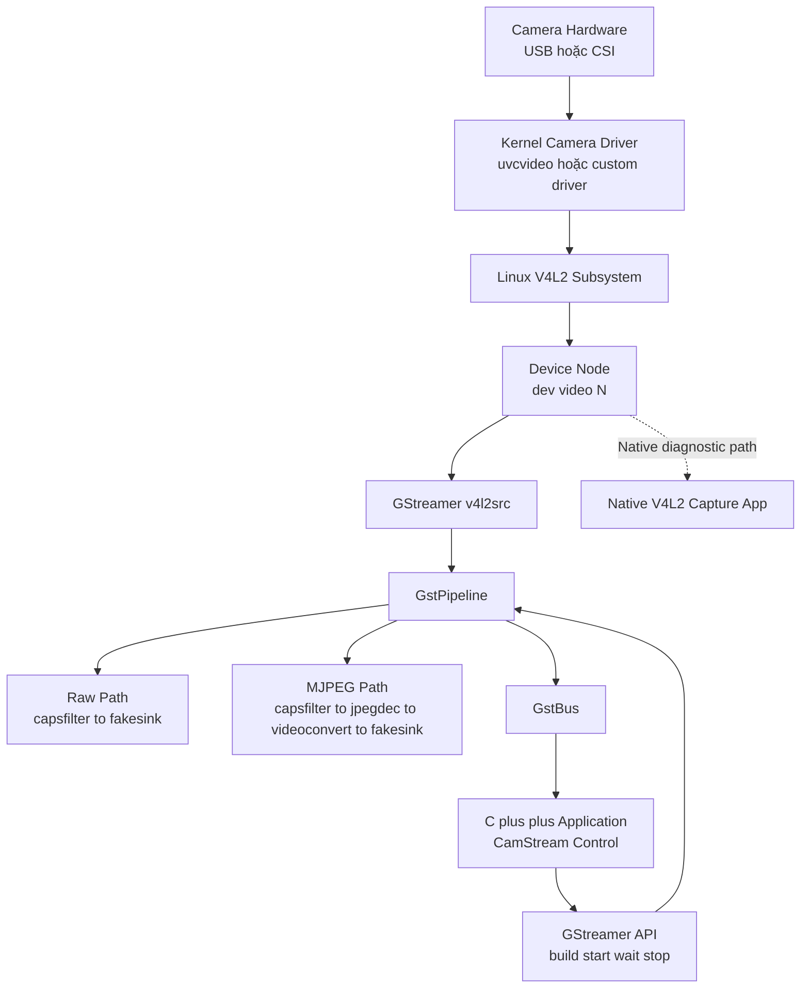

## Trách nhiệm từng tầng

| Tầng | Trách nhiệm chính |
|---|---|
| Hardware | Tạo tín hiệu hoặc frame camera |
| Kernel driver | Điều khiển thiết bị, DMA, interrupt và buffer queue |
| V4L2 | Chuẩn hóa userspace API |
| `/dev/videoN` | Character-device endpoint |
| `v4l2src` | Chuyển V4L2 capture thành GStreamer source dataflow |
| Pipeline | Quản lý graph, state, clock và Bus |
| Application | Cấu hình, start/stop, chờ kết quả và xử lý lỗi |

## Không được nhầm

```text
V4L2 không phải GStreamer.
v4l2src không phải kernel driver.
GStreamer không thay thế kernel camera driver.
Native V4L2 app vẫn cần để cô lập lỗi ở tầng thấp.
```

---

# 4. Object model và cách graph được hình thành

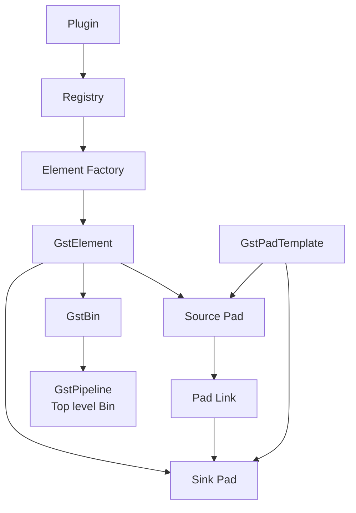

## Quan hệ cần nhớ

```text
Plugin
    chứa implementation

Registry
    biết plugin và factory nào tồn tại

Element Factory
    tạo element instance

Element
    thực hiện một chức năng media

Pad
    là cổng kết nối của element

Link
    nối source pad với sink pad

Bin
    quản lý một nhóm element

Pipeline
    là top-level bin quản lý runtime toàn graph
```

## Ownership quan trọng

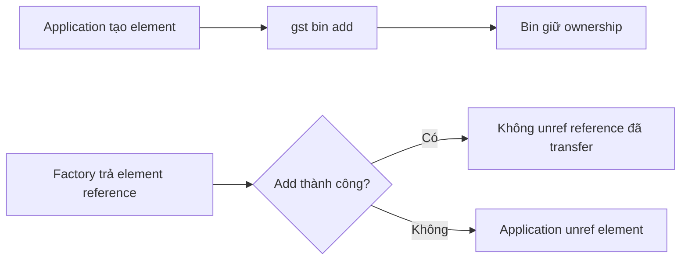

---

# 5. Các đường giao tiếp trong GStreamer

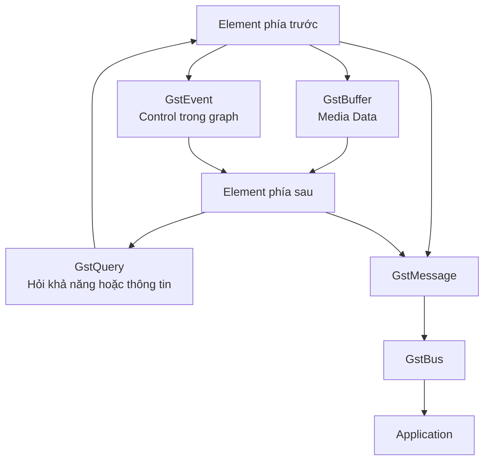

## Bốn loại luồng

| Luồng | Object | Hướng đi điển hình | Mục đích |
|---|---|---|---|
| Data path | `GstBuffer` | Phía trước → phía sau | Mang payload media |
| Event path | `GstEvent` | Thường xuôi hoặc ngược graph tùy event | Điều khiển dataflow |
| Query path | `GstQuery` | Request và response qua pad | Hỏi caps, allocation, duration... |
| Message path | `GstMessage` qua `GstBus` | Element → application | Báo EOS, lỗi, warning, state... |

## Điểm phân biệt

```text
GstEvent hoạt động bên trong graph.
GstMessage thông báo từ graph lên application.
EOS event đi trong graph.
EOS message xuất hiện trên Bus khi EOS hoàn tất tới mức phù hợp.
```

---

# 6. `GstBuffer`, memory và ownership

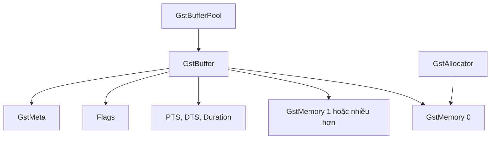

## Mental model

```text
GstBuffer
    = media-data object

GstMemory
    = vùng memory chứa hoặc tham chiếu payload

GstAllocator
    = cơ chế cấp và quản lý GstMemory

GstBufferPool
    = tái sử dụng buffer theo một configuration
```

## Reference counting và ownership

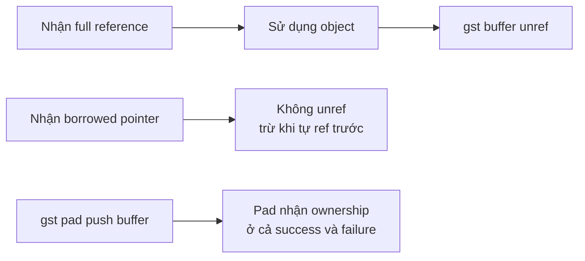

## Các quy tắc quan trọng

```text
GstBuffer là GstMiniObject, không phải GstObject.
Full reference phải được unref.
Borrowed reference không được tự unref.
gst_pad_push tiêu thụ reference được truyền vào.
gst_buffer_make_writable tiêu thụ reference đầu vào.
Buffer writable không đồng nghĩa mọi memory bên trong đã writable.
Map và unmap phải đi theo cặp.
```

## Một buffer có phải luôn là một frame?

```text
Không có quy tắc tổng quát 1 GstBuffer = 1 frame.

Ý nghĩa buffer phụ thuộc:
- media type;
- caps;
- metadata;
- contract của element;
- parser hoặc decoder.
```

---

# 7. Format: raw video, YUY2 và MJPEG

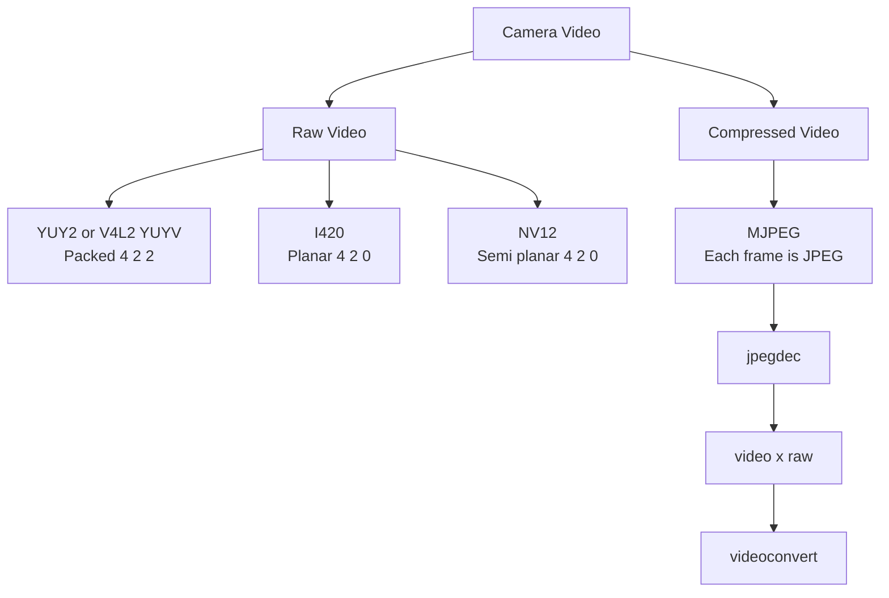

## YUY2 byte layout

```text
Y0 Cb0 Y1 Cr0 | Y2 Cb2 Y3 Cr2 | ...
```

```text
Hai pixel dùng 4 byte.
Mỗi pixel có Y riêng.
Hai pixel ngang chia sẻ Cb và Cr.
V4L2 gọi YUYV.
GStreamer gọi YUY2.
```

## Raw và compressed

| Đặc điểm | YUY2 | MJPEG |
|---|---|---|
| Media type | `video/x-raw` | `image/jpeg` |
| Payload | Raw packed pixels | JPEG codestream |
| Frame size | Gần cố định theo stride | Biến đổi theo nội dung |
| Decoder | Không cần | Cần `jpegdec` |
| USB bandwidth | Cao hơn | Thường thấp hơn |
| CPU decode | Không có bước JPEG decode | Có chi phí decode |

## Stride và kích thước

```text
YUY2 tightly packed:
row bytes = width × 2
frame bytes = row bytes × height

Thực tế:
frame storage = stride × height
stride có thể lớn hơn width × 2
```

Không dùng công thức raw-frame size cho MJPEG.

---

# 8. Caps và quá trình thương lượng format

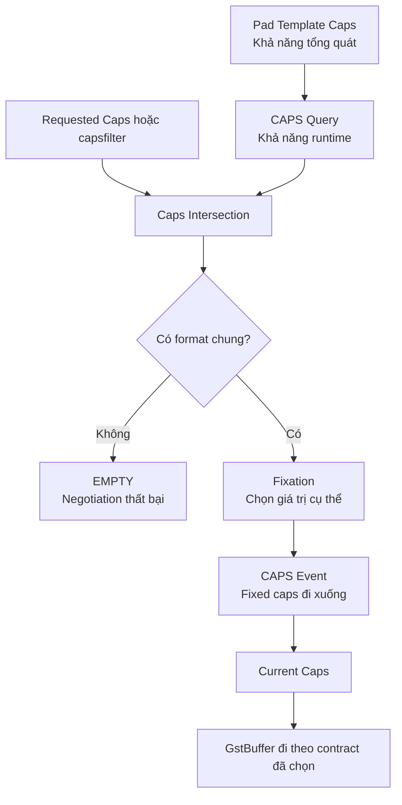

## Cấu trúc caps

```text
GstCaps
    ├── GstStructure + GstCapsFeatures
    ├── GstStructure + GstCapsFeatures
    └── ...
```

## Keyword cần nhớ

| Keyword | Ý nghĩa |
|---|---|
| Template caps | Khả năng tổng quát của pad type |
| Queried caps | Khả năng runtime tại thời điểm query |
| Allowed caps | Tập format còn khả dụng giữa hai pad |
| Requested caps | Constraint do application yêu cầu |
| Current caps | Fixed format đang dùng trên pad |
| Simple caps | Caps có đúng một structure |
| Fixed caps | Chỉ còn đúng một format cụ thể |
| `ANY` | Tương thích mọi format |
| `EMPTY` | Không có format nào |
| Caps features | Yêu cầu thêm như memory type |

## Quy tắc push-mode

```text
Element phía sau đề xuất.
Element phía trước quyết định.
Element phía trước gửi fixed caps xuống bằng CAPS event.
Element phía sau có thể gửi RECONFIGURE ngược lên.
```

## `capsfilter`

```text
capsfilter chỉ giới hạn caps.
capsfilter không decode, convert, scale hoặc thay đổi payload.
```

```text
jpegdec
    image/jpeg → video/x-raw

videoconvert
    raw format A → raw format B

videoscale
    kích thước A → kích thước B

videorate
    điều chỉnh nhịp frame ở tầng dữ liệu
```

---

# 9. V4L2 capture workflow và `v4l2src`

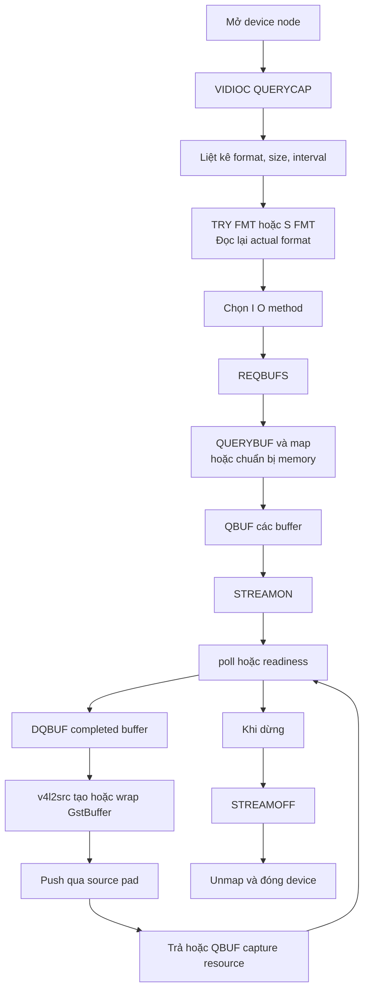

## Các I/O method

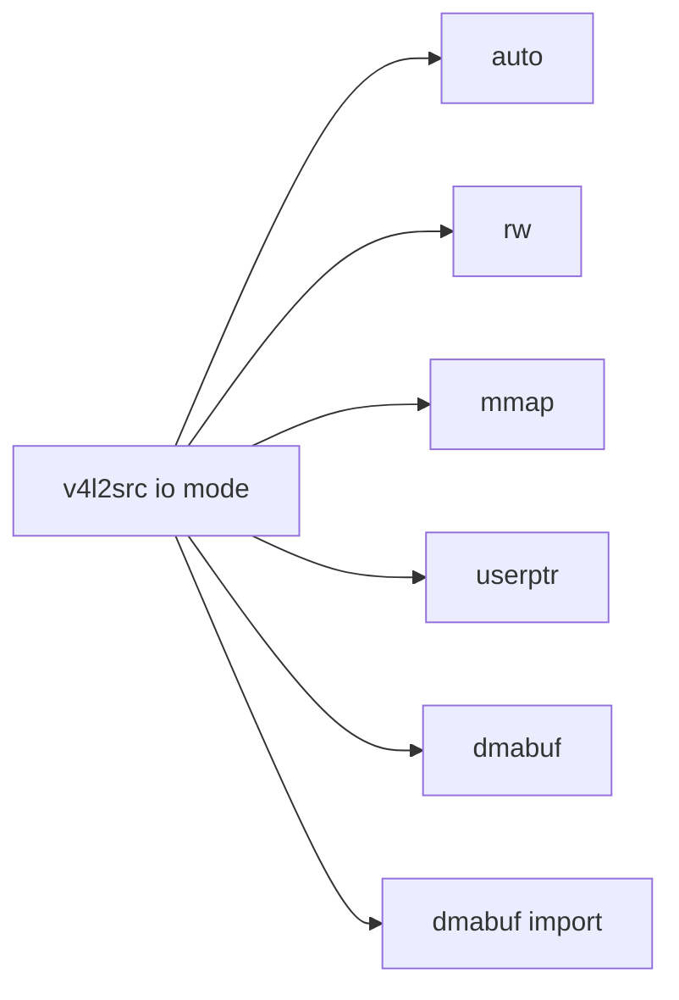

## Ownership của V4L2 buffer

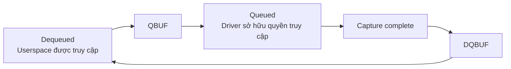

## V4L2 buffer và `GstBuffer`

```text
V4L2 buffer
    = descriptor và queue state giữa driver với userspace

GstBuffer
    = media object trong GStreamer graph
```

`v4l2src` là cầu nối giữa hai vòng đời này.

## `num-buffers`

```text
num-buffers = N với N > 0
    → source tạo N buffer rồi EOS

num-buffers = -1
    → không giới hạn
```

```text
num-buffers không phải số buffer trong V4L2 pool.
Trong CamStream, buffer_count = 0 nghĩa là không đặt property,
giữ mặc định num-buffers = -1.
```

---

# 10. Hai camera dataflow chính của CamStream

## Raw YUY2 path

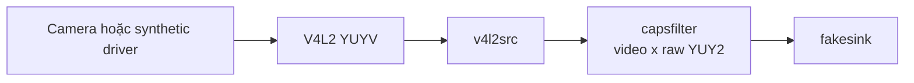

## MJPEG decode path

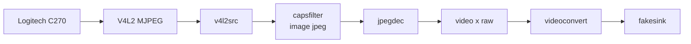

## Các kết luận được phép

```text
Synthetic YUY2 path đã functional-pass.
C270 YUY2 và MJPEG path đã functional-pass trong phạm vi validation.
Finite run có thể đạt EOS và pipeline về NULL.
```

## Các kết luận chưa được phép

```text
Chưa chứng minh stable delivered 30 fps.
Chưa chứng minh end-to-end zero-copy.
Chưa chứng minh long-duration USB reliability.
Chưa chứng minh production readiness chỉ từ functional pass.
```

---

# 11. State machine và live-source lifecycle

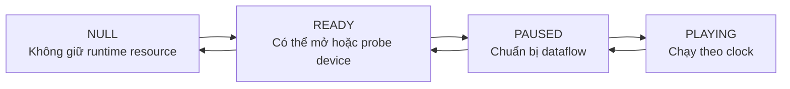

## Vai trò các state

| State | Ý nghĩa khái quát |
|---|---|
| `NULL` | Không giữ runtime resource |
| `READY` | Có resource tĩnh, chưa chạy dataflow |
| `PAUSED` | Chuẩn bị dataflow; non-live source thường preroll |
| `PLAYING` | Chạy theo pipeline clock |

## Live source

```text
Camera là live source.
Frame được tạo theo thời gian thực.
Live source thường không tạo buffer ở PAUSED.
Pipeline có thể trả NO_PREROLL.
```

## State transition result

```text
GST_STATE_CHANGE_SUCCESS
GST_STATE_CHANGE_ASYNC
GST_STATE_CHANGE_NO_PREROLL
GST_STATE_CHANGE_FAILURE
```

## CamStream lifecycle

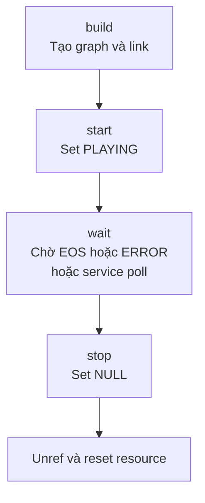

Quy tắc:

```text
Phải đưa pipeline về NULL trước khi unref nếu muốn release camera đúng lifecycle.
```

---

# 12. `GstBus`, `GstMessage` và application reaction

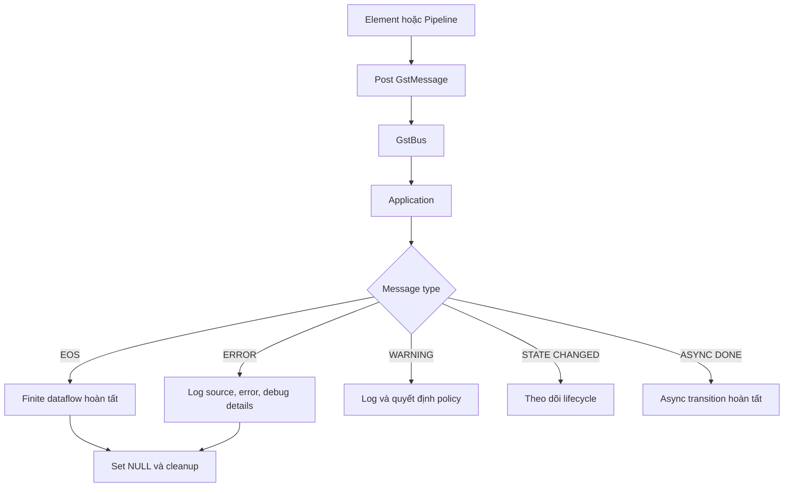

## Message quan trọng

| Message | Ý nghĩa |
|---|---|
| `GST_MESSAGE_EOS` | Dataflow hữu hạn đã kết thúc |
| `GST_MESSAGE_ERROR` | Lỗi terminal cần xử lý |
| `GST_MESSAGE_WARNING` | Cảnh báo không nhất thiết terminal |
| `GST_MESSAGE_STATE_CHANGED` | Một element đổi state |
| `GST_MESSAGE_ASYNC_DONE` | Async state transition đã hoàn tất |

## EOS không phải lỗi

```text
EOS
    = kết thúc luồng theo contract

ERROR
    = dataflow thất bại
```

## Ownership

```text
GstBus lấy từ pipeline phải được unref.
GstMessage lấy từ Bus phải được unref.
GError từ parse error phải được g_error_free.
Debug string phải được g_free.
```

---

# 13. Clock, timestamp, synchronization và backpressure

> Phần này thuộc chặng học tiếp theo sau Bài 8.

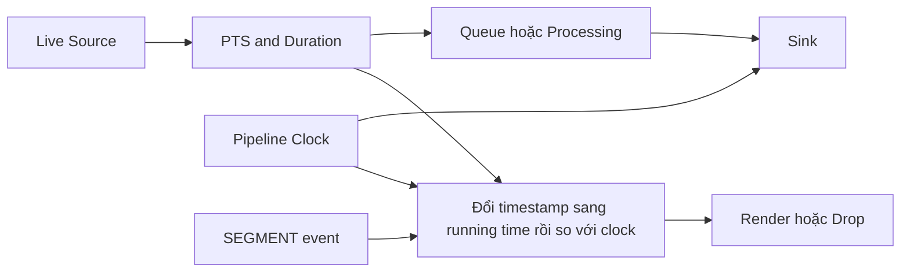

## Keyword

```text
PTS
DTS
Duration
Clock
Base Time
Running Time
Stream Time
SEGMENT / STREAM_START / CAPS
Latency
sync
is-live
QoS
Backpressure
Drop Policy
```

`STREAM_START` nhận diện stream, `CAPS` mô tả format, `SEGMENT` đặt timeline trước buffer. Running time dùng đồng bộ với clock; stream time biểu diễn vị trí nội dung. Sau seek, segment có thể đổi mà stream ID giữ nguyên. Xem [Bài 09](09-gstreamer-runtime-integration-and-interview-guide.md) và [GStreamer Streams](https://gstreamer.freedesktop.org/documentation/additional/design/streams.html).

## Backpressure

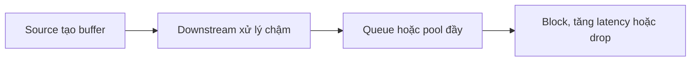

Không phải mọi pipeline đều nên “không bao giờ drop”. Camera real-time thường cần policy rõ ràng:

```text
Ưu tiên đầy đủ frame
hoặc
ưu tiên latency thấp và cho phép drop
```

`queue` leaky bỏ buffer tại queue khi đầy; QoS event truyền ngược upstream để element phản ứng với timing. Hai cơ chế có nguyên nhân và vị trí drop khác nhau. Xem [Bài 09](09-gstreamer-runtime-integration-and-interview-guide.md).

---

# 14. `tee`, `queue`, threading và nhánh xử lý

> Phần này thuộc chặng học nâng cao.

```mermaid
flowchart LR
    SRC["Source"] --> TEE["tee"]

    TEE --> Q1["queue 1"] --> DISPLAY["Display branch"]
    TEE --> Q2["queue 2"] --> RECORD["Record branch"]
    TEE --> Q3["queue 3"] --> AI["AI processing branch"]
```

## Vì sao cần `queue` sau `tee`?

```text
tee
    chia dataflow thành nhiều nhánh

queue
    tạo ranh giới thread và vùng đệm riêng cho nhánh
```

Nếu không có `queue`, một nhánh chậm có thể trực tiếp chặn nhánh khác tùy scheduling và graph.

## Các policy cần thiết

```text
max-size-buffers
max-size-bytes
max-size-time
leaky
flush-on-eos
```

Không chọn queue size tùy ý. Phải dựa trên:

- frame size;
- frame rate;
- latency budget;
- memory budget;
- drop policy.

---

# 15. Application integration với `appsink` và `appsrc`

> Phần này thuộc chặng học nâng cao.

```mermaid
flowchart LR
    PIPE["GStreamer Pipeline"] --> APPSINK["appsink"] --> SAMPLE["GstSample"] --> APP["Application Processing"]

    APP2["Application Producer"] --> APP_SRC["appsrc"] --> PIPE2["GStreamer Pipeline"]
```

## `appsink`

```text
appsink
    cho application nhận sample từ pipeline

GstSample
    thường chứa GstBuffer, GstCaps và segment liên quan
```

Application phải có policy cho:

- callback thread;
- buffer ownership;
- queue depth;
- blocking;
- drop;
- shutdown;
- frame lifetime.

## `appsrc`

```text
appsrc
    cho application đẩy buffer vào pipeline
```

Application phải cung cấp đúng:

- caps;
- timestamp;
- duration;
- live/non-live behavior;
- flow-control policy.

---

# 16. Debug workflow tổng thể

```mermaid
flowchart TD
    H["1 Hardware"] --> K["2 Kernel driver"]
    K --> N["3 Device node"]
    N --> C["4 Capability"]
    C --> F["5 Format và frame interval"]
    F --> V["6 Native V4L2 capture"]
    V --> P["7 Plugin và factory"]
    P --> G["8 Minimal GStreamer graph"]
    G --> X["9 Exact caps"]
    X --> D["10 Decoder hoặc converter"]
    D --> S["11 State và Bus"]
    S --> A["12 Application integration"]
```

## Công cụ theo tầng

| Công cụ | Dùng để làm gì? |
|---|---|
| `dmesg` | Kernel, USB, driver và disconnect |
| `v4l2-ctl --list-devices` | Tìm node |
| `v4l2-ctl --all` | Capability và configured state |
| `v4l2-ctl --list-formats-ext` | Format, size và interval |
| `v4l2-ctl --stream-mmap` | Native capture reference |
| `gst-inspect-1.0` | Plugin, factory, pad template và property |
| `gst-device-monitor-1.0` | GStreamer device discovery |
| `gst-launch-1.0 -v` | Thử graph và xem negotiated caps |
| `GST_DEBUG` | Theo dõi caps, pad, state, buffer và error |
| Application log | Lifecycle, message, timeout và cleanup |

## Failure-isolation pattern

```text
Native V4L2 fail
    → ưu tiên hardware, driver, node hoặc mode

Native V4L2 pass nhưng v4l2src fail
    → ưu tiên plugin, mapping, caps hoặc allocation

Compressed passthrough pass nhưng decode fail
    → ưu tiên parser, decoder hoặc raw negotiation

Minimal graph pass nhưng application fail
    → ưu tiên lifecycle, threading, Bus hoặc ownership
```

---

# 17. Bảng keyword ghi nhớ nhanh

## Kiến trúc và object model

| Keyword | Một câu ghi nhớ |
|---|---|
| Plugin | Module chứa implementation của element/type |
| Registry | Cơ sở dữ liệu plugin và factory |
| Factory | Tạo element instance |
| Element | Khối xử lý media |
| Pad | Cổng giao tiếp của element |
| Pad template | Mô tả pad và khả năng tổng quát |
| Link | Kết nối source pad với sink pad |
| Bin | Container quản lý element con |
| Pipeline | Top-level bin quản lý runtime graph |

## Dữ liệu và ownership

| Keyword | Một câu ghi nhớ |
|---|---|
| `GstBuffer` | Media-data object đi qua graph |
| `GstMemory` | Vùng memory chứa hoặc tham chiếu payload |
| `GstAllocator` | Cơ chế cấp `GstMemory` |
| `GstBufferPool` | Tái sử dụng buffer |
| Ref | Lấy thêm quyền sở hữu lifetime |
| Unref | Bỏ một reference |
| Writable | Có thể sửa object an toàn theo copy-on-write contract |
| Map | Lấy vùng địa chỉ CPU-accessible tạm thời |
| Meta | Thông tin bổ sung gắn với buffer |

## Format

| Keyword | Một câu ghi nhớ |
|---|---|
| `GstCaps` | Tập media format |
| `GstStructure` | Media type và typed fields |
| Caps features | Requirement như memory type |
| Fixed caps | Một format cụ thể |
| Current caps | Format đang dùng trên pad |
| `capsfilter` | Giới hạn caps, không đổi payload |
| `jpegdec` | JPEG thành raw video |
| `videoconvert` | Raw format A thành raw format B |

## Runtime

| Keyword | Một câu ghi nhớ |
|---|---|
| State | Mức resource và dataflow của element |
| Preroll | Buffer đầu tiên chuẩn bị cho non-live pipeline |
| Live source | Tạo dữ liệu theo thời gian thực |
| Clock | Nguồn thời gian của pipeline |
| PTS | Thời điểm trình bày buffer |
| Bus | Kênh message từ graph lên application |
| EOS | Kết thúc luồng, không phải lỗi |
| ERROR | Lỗi terminal |
| WARNING | Cảnh báo |
| Timeout | Giới hạn thời gian chờ |

## Linux camera

| Keyword | Một câu ghi nhớ |
|---|---|
| V4L2 | Linux userspace media API |
| `/dev/videoN` | Character-device node, không phải stable identity |
| `v4l2src` | GStreamer source dùng V4L2 |
| `QUERYCAP` | Kiểm tra capability |
| `S_FMT` | Đặt format và nhận giá trị driver normalize |
| `REQBUFS` | Yêu cầu buffer set |
| `QBUF` | Giao buffer cho driver |
| `DQBUF` | Nhận completed buffer |
| `STREAMON` | Bắt đầu capture |
| `STREAMOFF` | Dừng capture |
| MMAP | Driver buffer được map vào userspace |
| DMA-BUF | Chia sẻ buffer bằng file descriptor |

---

# 18. Các phản biện bắt buộc phải nhớ

```text
GStreamer pipeline là graph, nhưng không phải mọi graph đều tuyến tính.

Link thành công
    không đồng nghĩa negotiation thành công.

Negotiation thành công
    không đồng nghĩa thiết bị giao đúng FPS thực tế.

Current caps có framerate 30/1
    không đồng nghĩa delivered ổn định 30 fps.

Raw YUY2
    không đồng nghĩa zero-copy.

DMABUF
    không đồng nghĩa end-to-end zero-copy.

Một GstBuffer
    không phải lúc nào cũng đúng một frame.

Số GstMemory
    không tự động bằng số video plane.

v4l2src
    không phải kernel driver.

num-buffers
    không phải V4L2 pool size.

EOS
    không phải ERROR.

Unref pipeline
    không thay thế việc đưa pipeline về NULL đúng lifecycle.

Functional pass
    không đồng nghĩa production readiness.
```

---

# 19. Cách tự ôn bằng sơ đồ

## Vòng 1 — Nhớ object

Tự trả lời:

```text
Plugin tạo gì?
Factory dùng để làm gì?
Element kết nối bằng gì?
Bin và Pipeline khác nhau thế nào?
```

## Vòng 2 — Nhớ dataflow

```text
Payload nằm ở đâu?
Format được mô tả bằng gì?
Ai thương lượng format?
Buffer đi theo hướng nào?
Event, Query và Message khác nhau thế nào?
```

## Vòng 3 — Nhớ camera flow

```text
Camera frame đi từ hardware lên GstBuffer qua những tầng nào?
V4L2 buffer và GstBuffer khác nhau ra sao?
Khi nào capture buffer được trả lại driver?
```

## Vòng 4 — Nhớ runtime

```text
NULL, READY, PAUSED và PLAYING khác nhau thế nào?
Live source khác file source ở đâu?
Application nhận EOS và ERROR bằng gì?
```

## Vòng 5 — Debug

```text
Native V4L2 có pass không?
Minimal GStreamer graph có pass không?
Exact caps có pass không?
Decoder path có pass không?
State và Bus báo gì?
```

---

# 20. Tóm tắt cuối cùng

```mermaid
flowchart LR
    ARCH["Object Model<br/>Plugin Element Pad Pipeline"] --> DATA["Data Model<br/>Buffer Memory Ownership"] --> FORMAT["Format Model<br/>Caps YUY2 MJPEG"] --> CAMERA["Camera Input<br/>V4L2 v4l2src"] --> RUNTIME["Runtime<br/>State Clock Live Source"] --> CONTROL["Application Control<br/>Bus Message Error"] --> SCALE["System Design<br/>tee queue appsink latency"]
```

```text
Muốn hiểu GStreamer chắc chắn, phải nắm đồng thời:

1. Graph được tạo từ object nào.
2. Dữ liệu và ownership đi như thế nào.
3. Format được mô tả và thương lượng ra sao.
4. Nguồn camera đi vào graph qua V4L2 như thế nào.
5. State machine quản lý resource và dataflow ra sao.
6. Bus đưa kết quả và lỗi về application như thế nào.
7. Threading, queue và latency được kiểm soát bằng policy nào.
```

---

# 21. Nguồn nội dung của sơ đồ

Sơ đồ được hệ thống hóa từ các bài học trong bộ CamStream GStreamer:

1. Bài 1 — Tổng quan GStreamer trong Camera Embedded Linux.
2. Bài 2 — Plugin, Element, Pad, Link, Bin và Pipeline.
3. Bài 3 — `GstBuffer`, `GstMemory` và ownership.
4. Bài 4 — Raw video, YUYV/YUY2 và MJPEG.
5. Bài 5 — `GstCaps` và caps negotiation.
6. Bài 6 — V4L2, `v4l2src` và camera capture.
7. Bài 7 — State machine và live-source lifecycle.
8. Bài 8 — `GstBus`, `GstMessage` và error handling.

Các chủ đề sau Bài 8 được đánh dấu là phần học nâng cao, không phải bằng chứng rằng CamStream hiện đã triển khai đầy đủ:

- clock và synchronization;
- `tee` và `queue`;
- threading và backpressure;
- latency và drop policy;
- `appsink` và `appsrc`;
- application/service integration.
